# What changed after the Oct 22 walkthrough

For engineers, product, growth and the founders. This page covers the set of changes we built after the walkthrough. In the code it is the branch `feat/walkthrough-refinements` (Oct 25, 2026), which also carries the latest develop. It says what you will notice, why we changed it, and where to read more. It links to the detailed docs instead of repeating them.

A few terms used below. The **MD** is the managing director running the deal, which is Storm. The **Console** and the **Book** are two views of the Conductor Center home screen. A **Preview** is a screen you can try that does not save anything yet. **E-numbers** (such as E19) are items in the engineers' handoff list, and **C-numbers** (such as C-25) are items on Lance's review list. You can ignore them unless you want the detail. **develop** is the main line of the code before these changes.

- [Engineer handoff](../03-engineering/walkthrough-handoff-2026-10-22.md): database, permission and server work, plus the questions for Storm, Marco and counsel.
- [Walkthrough principles and lessons](walkthrough-principles-2026-10-22.md): the rules we now build by.
- [Rail multiplayer and dependencies proposal](rail-multiplayer-and-dependencies-proposal.md): the decisions Storm needs to make about the rail.
- [Designer pack for Marco](../design/walkthrough-designer-pack-2026-10-22.md): inspiration, screens and the agenda for the two-day view session.
- Flow map, As-is and To-be: https://claude.ai/artifact/QCTbaipHwi8T59vQ92EUgg (private; ask Lance for access) (source: [docs/design/user-flows](../design/user-flows/index.html)). It draws the screens and how a person moves between them, before and after.

## In one minute

- **Plain English everywhere.** Engineering labels, deal codes and numbered references are gone from the screens. An automatic check now fails if banned jargon or em dashes come back. The meeting's rule: "Never make somebody use a reference for something that they have to go look up."
- **A Conductor Center for 10 to 50 deals.** The Conductor Center is the home screen across all your deals. It opens with what needs your judgment, one button each. Below that is one compact, sortable list of your deals with a phase meter, the current step, who is on it and the target close.
- **A rail you zoom into, like a Trello board.** The rail is the step-by-step workflow of one deal. Five phase cards run left to right. Press a phase to see its steps as stacked cards, press a step to zoom in with its neighbors either side, and press Escape to zoom back out.
- **The rail shows who is doing what.** Every open step shows its owner. Only the MD assigns steps. Cards say what happened last ("Draft saved by Alex Chen"), and a teammate's work appears without you reloading the page.
- **People screens make sense.** Team means who is on this deal, and a person opens in place. Firm seats (the people at your firm who have a login) moved into Settings. "Invite to deal" is for colleagues. Outside parties get data room access from the Data Room.
- **Mail looks like Outlook, and the audit trail names people.** Mail has folders, a list and a reading pane. Mail settings moved to Settings. The Audit Trail has a Person column.
- **Nothing unsaved looks saved.** Some flows need engineers to change how data is stored or who may do what. Until then, those flows run as a Preview in your browser, with a "Preview" label and a Reset button. We made no such changes in this set of work. The engineers' to-do list covers them.

## By area

No screenshots of develop were taken before the work began. So for each change, the "before" is the meeting itself: the quote under "Why" and the meeting notes. The "after" screens come from the new code with demo data, on a wide laptop screen (1440 pixels).

### Conductor Center

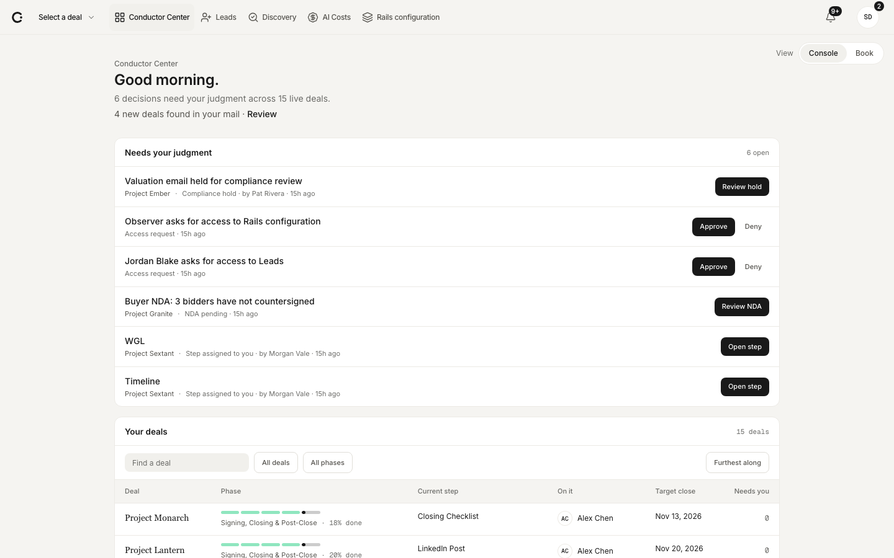

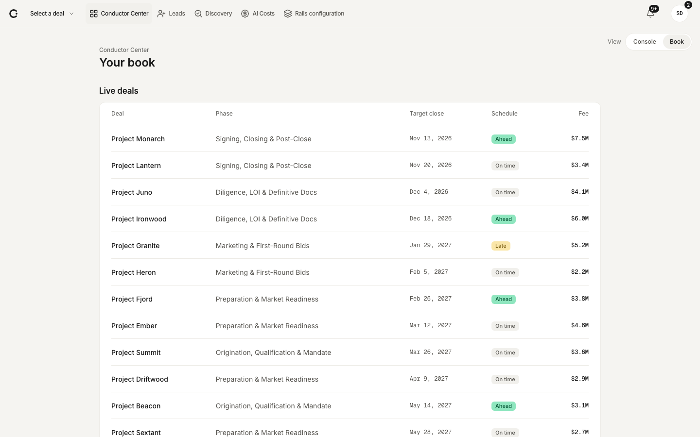

**What needs you comes first.**
- What you will notice: the Console opens with a greeting that counts the decisions waiting, then "Needs your judgment". (The Console is the action view. The Book is the full list of deals.) Each item has one main button, such as Review hold, Review NDA, Open step or Approve. Acting on an item takes it off the list.
- Why: "Surfaced to you is everything that needs you now ... you can basically come in and approve each step that the agent has completed."
- Screens: before, see the meeting notes. After, the Console above.

**Your deals, as one list that scales.**
- What you will notice: "Your deals" is one compact list. Each row shows the deal name, a five-part phase meter, the phase name, percent done, the current step, who is on it (or Unassigned), the target close and how many items need you. Search, Show, Phase and Sort appear once you have six or more deals.
- Why: "I can't scan this if there are 50, so I'd love for that to be evolved."
- Screens: before, see the meeting notes. After, the Console above.

**New deals found in your mail.**
- What you will notice: a line reads "4 new deals found in your mail · Review" and links to Discovery. It shows nothing when there are none. The wording is an invitation about your own mail, never "watching" or "monitoring".
- Why: "Do you want to add it in? I would say the latter, as long as people don't feel like we're Big Brothering them."
- Screens: before, see the meeting notes. After, the Console above.

**Less noise.**
- What you will notice: the numbered entry lines, step-number chips and raw role keys are gone from the deal rows. The Book uses phase names and plain On time, Ahead and Late labels. Its sample-data notices are gone. One "View" control switches between Console and Book and remembers your choice.
- Why: "If there is anything on the page that increases noise but does not increase value ... remove it."
- Screens: before, see the meeting notes. After, both views above.

**"Running" waits for real data.**
- What you will notice: a "Running" card with a moving bar exists, but it stays hidden. Nothing records when Conductia is drafting yet, and we chose an empty space over a guess. Engineers need to start recording it first. That is item E19.
- Why: "I want to actually know what's going on."
- Screens: not shown, because it is hidden.

**The deal home reads like an app.**
- What you will notice: the codename shows once, with no code line under it. The page leads with working content, including "Open current step: {step}", and has no centered headline block.
- Why: "It just needs to feel more like an app and less like a site."
- Screens: before, see the meeting notes. After, try it locally (no final screenshot).

**A demo book with real activity.**
- What you will notice: Storm's local demo has 15 live deals across all five phases. It includes items that need you, mail held for review, deals proposed from mail Discovery, AI spend for four people, and Leads (prospects) drawn from the demo deals.
- Why: "Assume I have 10 different engagements I'm part of in some way. Do I actually have a grasp on what I need to do and what's going on?"

### Rail

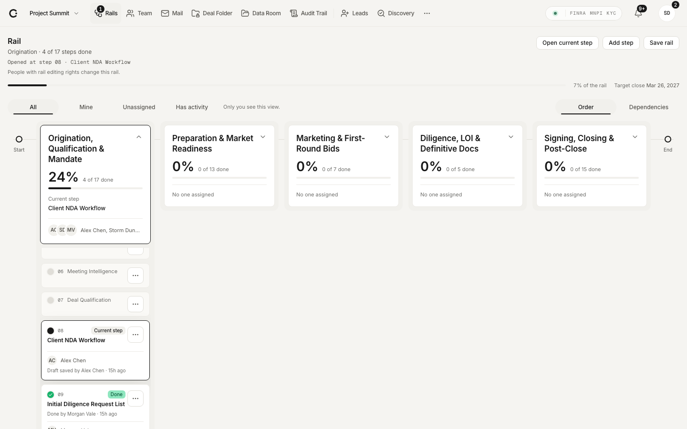

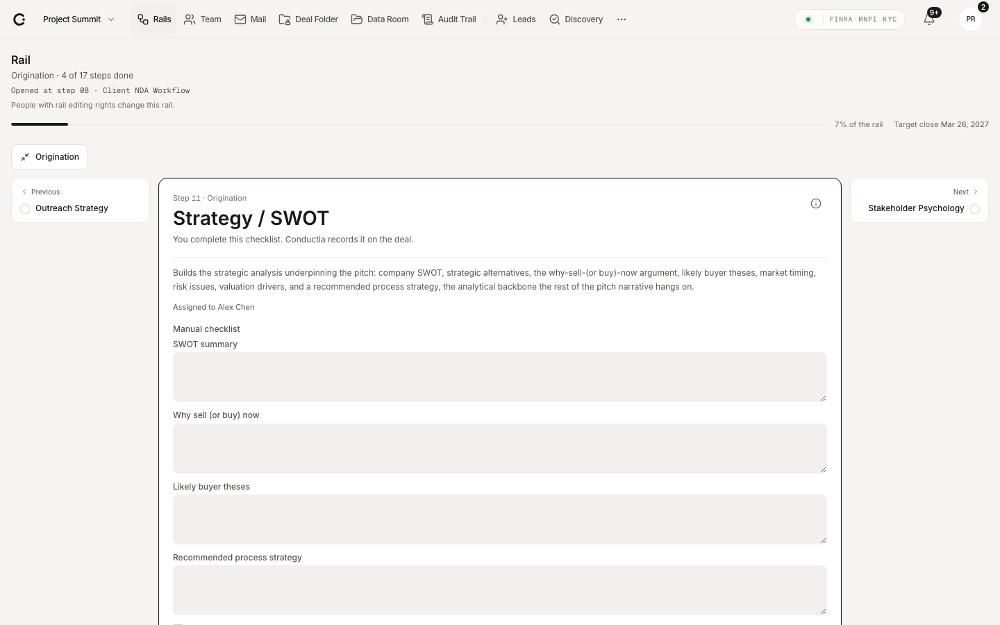

**Zoom replaces the two-view toggle.**
- What you will notice: five wide phase cards run left to right between Start and End. Each shows its percent done, "N of M done", the current step and who is working in it. Press a phase to open its steps as stacked cards. Press a step to zoom in, with the previous and next steps named either side. Escape or the zoom-out button returns to the board with that phase open. The zoom animates, and it switches instantly for people who prefer reduced motion. It works from the keyboard, a link to a step opens it zoomed, and phones stack the phases.
- Why: "I would probably have a view that's showing me 1, 2, 3, 4, 5 up top with the ability to expand into those." And: "I could be in a zoomed-in step right now and I could have the step before and the step after accessible on the sides."
- Screens: before, see the meeting notes. After, the board and zoomed step above.

**One progress line, and the deal named once.**
- What you will notice: the header reads "Origination · 4 of 17 steps done", with one overall bar and the target close. The deal code appears only inside the open deal switcher menu. Phases always carry their names, and the step the deal is on reads "Current step", never "In progress".
- Why: "On the top it says SUM-2026-014. Like what the hell is that and why is that necessary?" And on the old header: "There's some redundant information."
- Screens: before, see the meeting notes. After, the board above.

**Who is doing what.**
- What you will notice: every open step card names its owner or says "Unassigned". Only the MD sees "Assign..." in a card's menu, and assigning asks for a confirm that says who gets notified. Cards show the last thing done, such as "Draft saved by Alex Chen · 15h ago" or "Done by Morgan Vale". A step finished ahead of the current one shows Done. The views All, Mine, Unassigned and Has activity are marked "Only you see this view." A teammate's work appears when you return to the browser tab, or within 30 seconds.
- Why: "Someone, player 1, is over in step 5 working on something. And player 2 is in step 1 still working on something. That's totally fine."
- Screens: before, see the meeting notes. After, the board above (card 08 and card 09).

**Who can change the rail, and a prompt after you do.**
- What you will notice: everyone sees "People with rail editing rights change this rail." After an editor adds or removes a step, a dialog says "This changes the rail for everyone on this deal". It offers "Apply to this deal", "Apply and save as a company rail..." and "Don't ask again". "Don't ask again" shows "You can change this in Settings" for about two seconds. Settings › Rails has the "Ask before changing the rail" switch to bring it back. People without edit rights never see the prompt.
- Why: "Adobe's really good at this. I do something and it will go, are you aware that you did this?" And: "Give me 3 options right now. Do I want to save this as a new rail? ... Do I want to ignore it? ... Also stop asking me this."
- Screens: before, see the meeting notes. After, the move version of the prompt under Previews.

**"Draws on" lives in step detail.**
- What you will notice: step detail lists the steps it "Draws on", labeled "From the step brief", with each one's status. The rail never shows "Blocked", because nobody has decided the dependency rules yet.
- Why: "What steps need to be completed prior to another step being available."

**Rails configuration is easier to scan and edit.**
- What you will notice: the template list has a search box and "Built in" and "Saved by your firm" groups. The New template dialog says "Starts from your default rail". You click a description to type in it, Enter saves and Escape cancels. Text under "Publish changes" says who gets the change. Steps every deal needs show a lock and cannot be removed.
- Why: "Probably not ideal when you start to have like 6 or 7 different rails." And: "They should be like crazy easily editable, drag and drop."
- Screens: before, see the meeting notes. After, below.

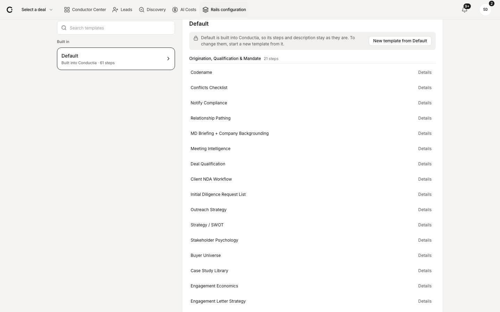

### Steps and skills

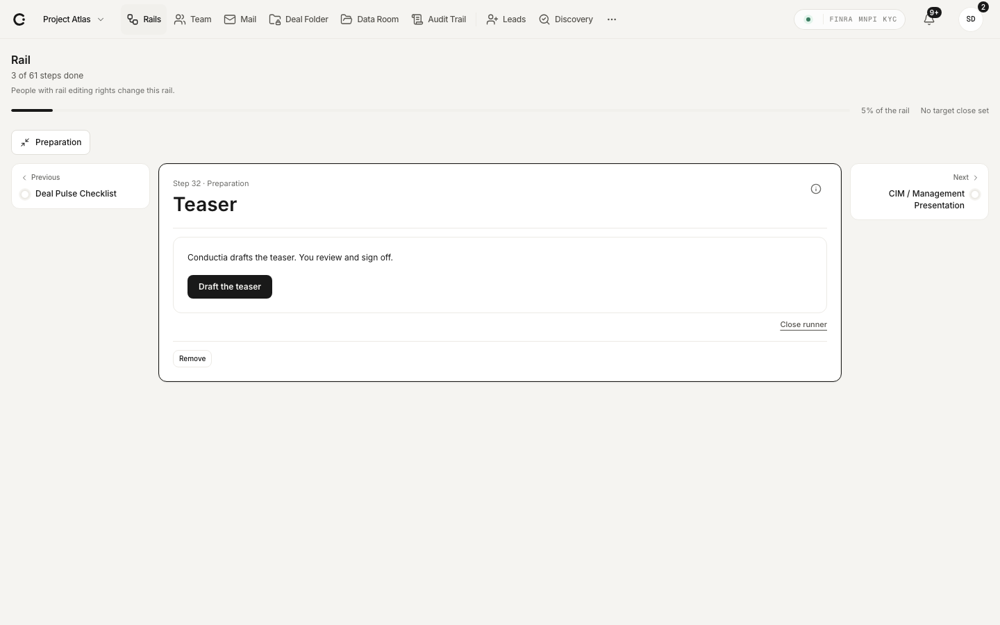

**Each step says what will happen.**
- What you will notice: the step name is the largest text, with "Step 32 · Preparation" small above it. One plain line says who does what: "Conductia drafts the teaser. You review and sign off." Engineering labels and build notes are gone.
- Why: "Step name, super important. Phase position, 0% important." And: "We live in a world where plain English works."
- Screens: before, see the meeting notes. After, the teaser step above.

**Buttons name what they make.**
- What you will notice: "Draft this step" is gone. Buttons read "Draft the teaser", "Draft the MD brief" or "Draft with the {step} skill". On skill steps, the old "Mark complete" now reads "Move to the next step" and says it does not record the step as done. Manual steps keep "Mark step complete".
- Why: "I don't even know what draft this step does."
- Screens: before, see the meeting notes. After, the teaser step above.

**Say what should change in a draft.**
- What you will notice: a finished draft shows a "What should change?" box. Example requests sit under it as hint text, not as preset buttons. Submitting creates the next version of the draft, using the revision feature that already existed, so it is saved for real.
- Why: "It looks like it's generated version 2 and now it's like, how do I improve from version 2? ... I feel like we almost need a free text."

**The teaser drafts clean by default.**
- What you will notice: the teaser scenario picker is gone. The compliance supervisor, the automatic check that screens every draft, still runs. The local sample draft says "Sample draft. Not written from this deal's data", and the headline has no em dash.
- Why: "What if I don't need to like clean the voice or remove some of the compliance things."
- Not changed: building the rules about material non-public information (MNPI) and promissory language into the skill instructions themselves. That is engineer item E9.

**Add step puts the name and the skill first.**
- What you will notice: the step name is the first field. The conversation and the skill preview fill the main area. Placement is one line, "Adds after: {step} · Change", and Change now offers "Before" too. It defaults to where you are. After "Save skill and add step", the new card lands highlighted on the board.
- Why: "Step name, super important. Phase position, 0% important. Conversation and skill preview, very important." And: "It's like before or after, start of phase, end of phase ... It's very clunky."
- Screens: before, see the meeting notes. After, below.

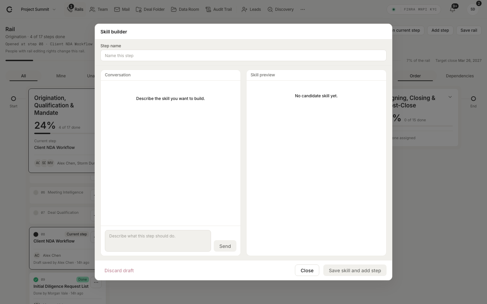

**US dates everywhere.**
- What you will notice: every date comes from one formatter and reads like "Oct 7, 2026", whatever your browser language.
- Why: "I also just realized that's not DDMMYY."

### Team and Settings

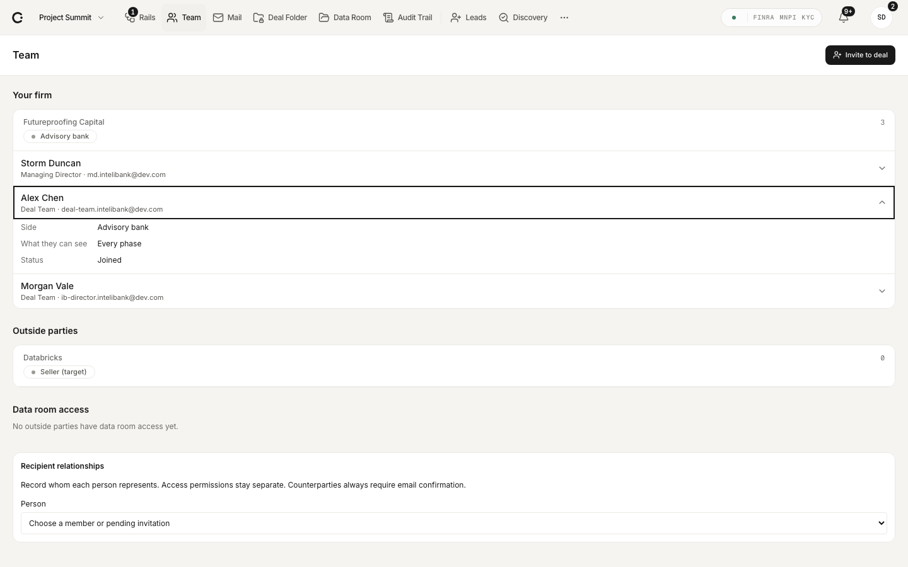

**A person opens in place.**
- What you will notice: on Team, clicking a person opens their details under their row, one person at a time, with no side panel. The page groups "Your firm", "Outside parties" and a read-only "Data room access" list. Details use plain words: "What they can see" with phase names, and "Joined".
- Why: "Let me hamburger UI right there. Don't make me go over to another part of the screen to close on something."
- Screens: before, see the meeting notes. After, Team above.

**"Invite to deal" is for colleagues.**
- What you will notice: "Invite to platform" is now "Invite to deal" everywhere, and from Team it offers colleagues at your firm only. Outside people are invited from the Data Room with "Give data room access". That uses the outside invite that already existed. No permission rules changed.
- Why: "An invite to platform feels way too ... It's very vague." And: "For now, the only people you're inviting to a deal is internal."

**Firm seats move into Settings.**
- What you will notice: "My organization" is gone from every navigation bar. Settings, from the avatar menu, holds Profile, Organization, Mail, Rails and Notifications. Old organization page addresses send you there, and directors and firm administrators also get an Organization link in the avatar menu. Members are grouped by role, with search and "Filter by role". Tick two or more people and press "Set access" to give them the same access, and each person gets their own result. A member opens read-only until you press "Edit access". Controls you cannot use are locked with a reason.
- Why: "This now feels like who has a seat in my full company ... Should be in like probably settings or something." And: "I'm going to open Storm Duncan and Morgan Vale at the same time and make sure they have the same permissions."
- Screens: before, see the meeting notes. After, below.

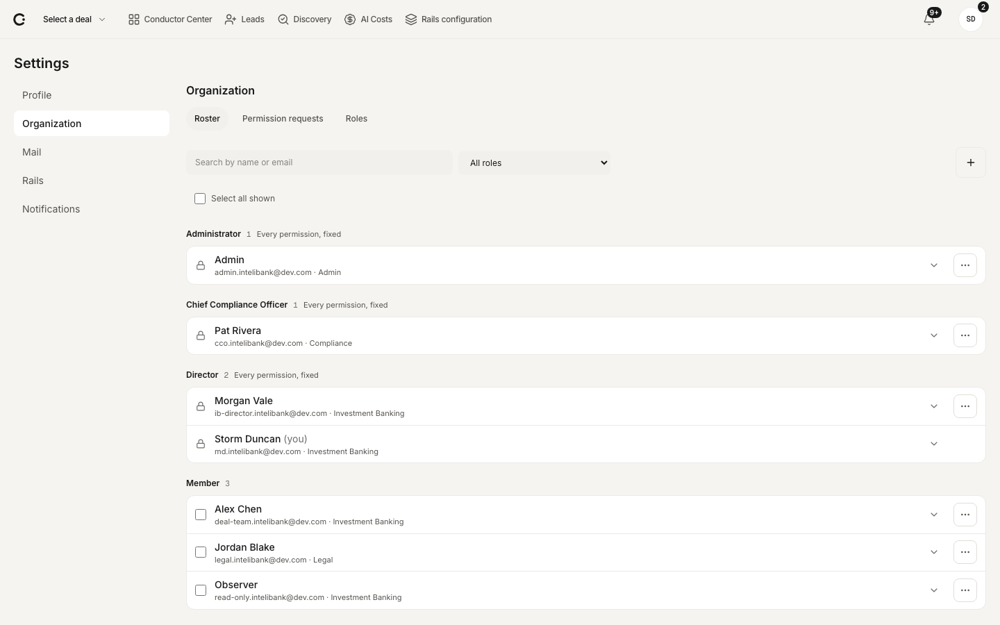

**Roles shown as they are.**
- What you will notice: invite dialogs offer only the roles the system will actually grant. One line explains that the Chief Compliance Officer and Administrator roles are set up by Conductia: "To change one, contact Conductia." "Administrator" now means only the firm administrator. An outside company's director reads "Director".
- Why: "How did the chief compliance officer and admin role even get on here if you can't even invite someone with that role?"

**Count badges where the work is.**
- What you will notice: Rails, Team, Mail and Settings show unread counts on their icons. A deal's badges count only that deal. Clicking a badge opens the newest unread item and marks it read. The bell stays as the full inbox, and counts refresh when you come back to the tab.
- Why: "Give me a dot with a number on its icon up there somewhere that tells me there's something that needs your attention specifically here."
- Screens: before, see the meeting notes. After, below.

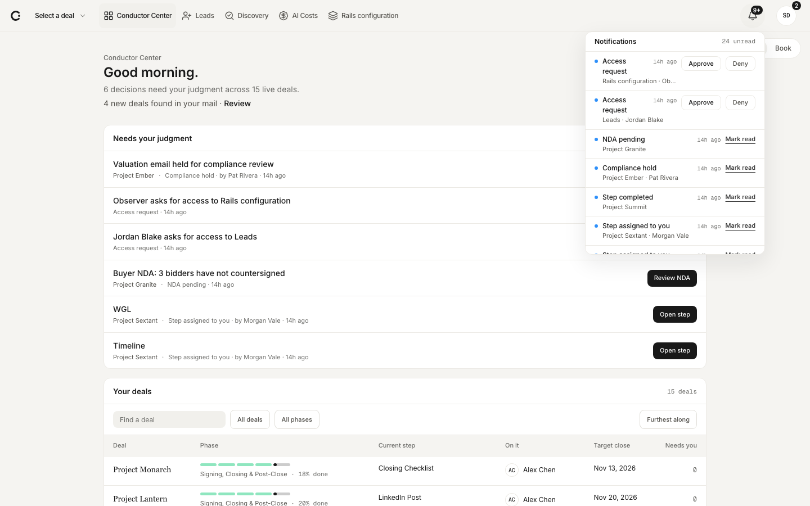

**One way for windows to open.**
- What you will notice: create and confirm actions use one centered dialog box. Every 3-dot button opens the same menu. Record details open in place, and the panels that slid in from the right are gone. Small panels with fields use a small floating box next to the button. All of them share one dimmed backdrop and one motion. The skill builder and the output review are the two exceptions.
- Why: "It's just all nothing standardized, like the modals, the components, the way things move in and out of the screen."

**Navigation.**
- What you will notice: Leads and Discovery now have their own labeled links in the navigation. On a phone, the bottom bar holds at most five entries plus "More".

### Mail

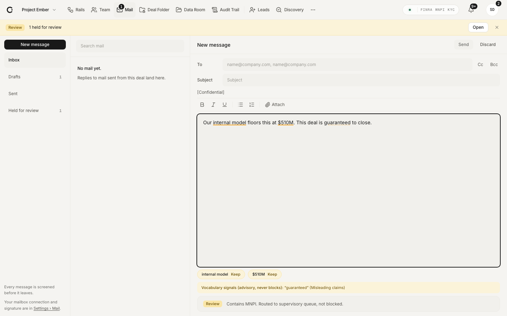

**Mail that feels like Outlook.**
- What you will notice: folders sit in a left column (Inbox, Drafts, Sent). "Held for review" and "Blocked" appear only while they hold messages. Mail reads as folders, message list and reading pane, and "New message" opens the composer in the pane. Phones show one pane at a time. The compliance flags, sign-off and risk dialogs are unchanged.
- Why: "It should feel as though most of these people are on Outlook/SharePoint." And: "We can't include all functionality of ... the Outlook client, but we just need the primary ones."
- Screens: before, see the meeting notes. After, the composer above.

**Settings leave the mail screen.**
- What you will notice: the "Mail settings" button is gone from Mail. Settings › Mail holds the mailbox cards, the signature Preview and, for the CCO or an admin, the compliance settings. The mailbox card speaks plainly, and a member who needs a seat gets a direct link to a deal's Team page. Ticket numbers and audit wording are gone from Mail.
- Why: "Currently you go to mail settings and it's like, you have to go to your own mailbox settings."
- Screens: before, see the meeting notes. After, below.

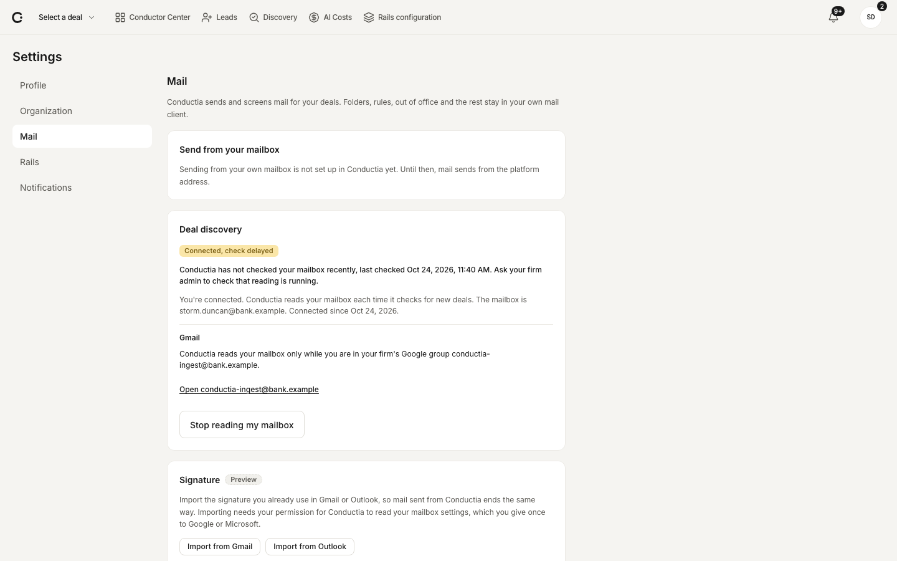

**A plain stop before risky mail.**
- What you will notice: Send is blocked, with a plain reason, when a message cannot be matched to a deal and a recipient is outside the sender's email domain (the part after the @). The system behind the screen still allows that send. That gap is item E24 in the engineers' "Fix first" list.

### Documents and Audit

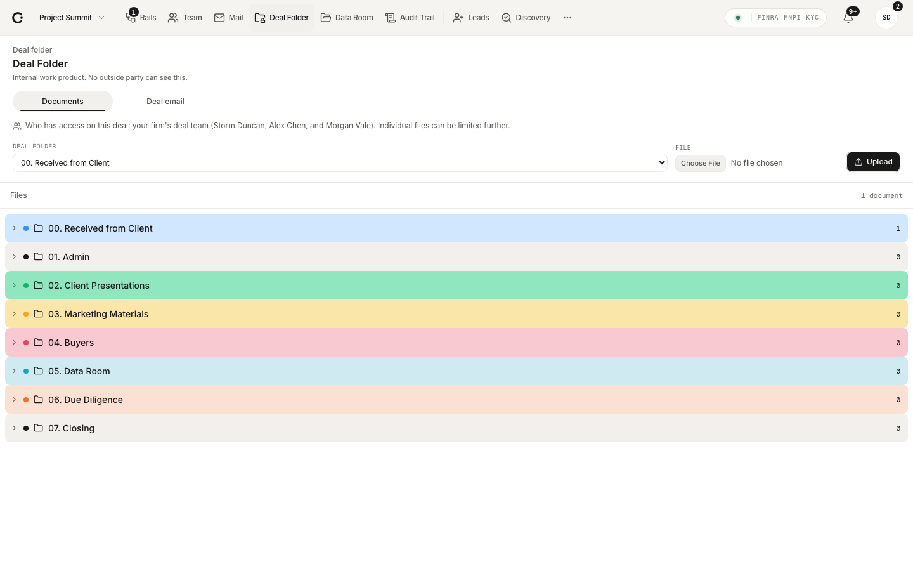

**Deal Folder: color, full width and who has access.**
- What you will notice: the eight categories each have their own soft color. The list uses the full width until you pick a document, and files that cannot be previewed get a download bar instead of an empty pane. A line names who has access on this deal.
- Why: "I found that honestly color coding some of that stuff helps immensely." And: "Why do we have this huge preview space if we can't even see the preview?"
- Screens: before, see the meeting notes. After, the Deal Folder above.

**Data Room: where outside invites start.**
- What you will notice: the Data Room has "Give data room access" and the same "Who has access on this deal" line. It shares the Deal Folder's colors as pills but stays a flat table. Whether it should match the Deal Folder is a question for Marco.
- Why: "If I clicked on team, I would want to know who has access to the data room."

**Audit Trail: a Person column.**
- What you will notice: every row names who acted. Your own rows read "You", and rows written by the system read "Conductia". Overrides read "Sent despite a compliance flag" and "Flagged at screening, sent anyway". Dates read like "Oct 7, 2026", and the exported file is named conductia-audit. A failed load says so, with Try again, instead of "0 events".
- Why: "Doesn't look like it has a person, actually. But we should add that."
- Screens: before, see the meeting notes. After, below.

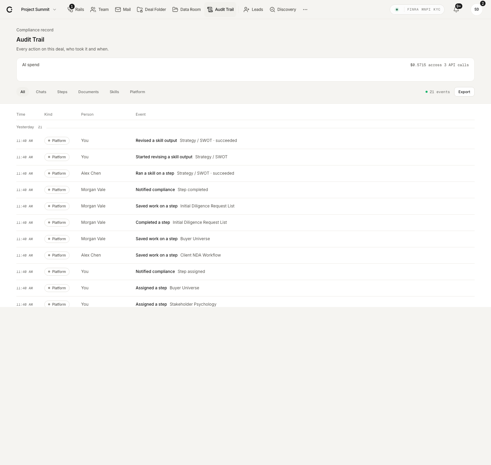

### Sign-in and profile

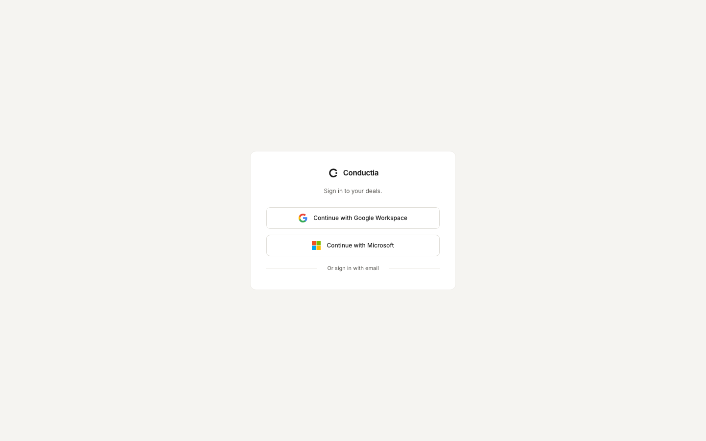

**Google and Microsoft first.**
- What you will notice: with work sign-in on, Google and Microsoft come first, then "Or sign in with email". The email fields appear only after you press it. With work sign-in off, the email form shows alone.
- Why: "The standard is for the continue with Google or Microsoft to be the default, and then a manual login is on the bottom actually. I prefer that."
- Screens: before, see the meeting notes. After, the sign-in above.

**A stripped-down profile.**
- What you will notice: Settings › Profile holds only photo, full name, nickname, title, role and email. Hovering over or selecting the avatar shows "Change photo". Copy email, Add photo, Remove photo and "Last synced just now" are gone. Full name and nickname have pencils and save. Title has a pencil but is a Preview. Directors and firm administrators can set a "Default deal role". Everyone else sees it as text. The photo is kept in this browser only and is not saved to your account.
- Why: "So this whole thing, I'm like, I think we could kill almost everything." And: "Definitely get rid of copy email, add photo, remove photo."
- Screens: before, see the meeting notes. After, below.

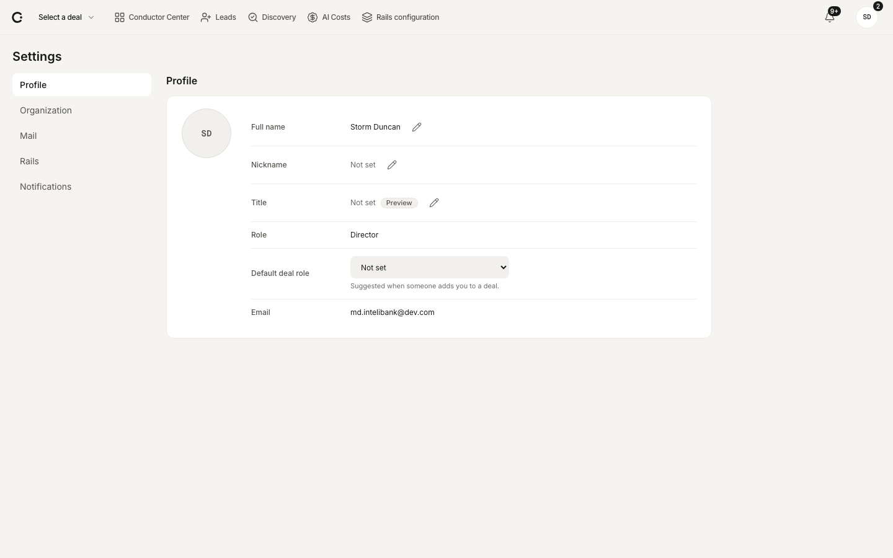

## Previews

A Preview lets you feel a flow that needs database or permission work before engineers build it. It runs in your browser only and carries the "Preview" chip ("Not saved yet. Engineers are wiring this.") or the banner "Preview. Only you see this. Nothing here is saved to the deal." Reset or a reload brings back the saved state. No Preview ever says "Saved".

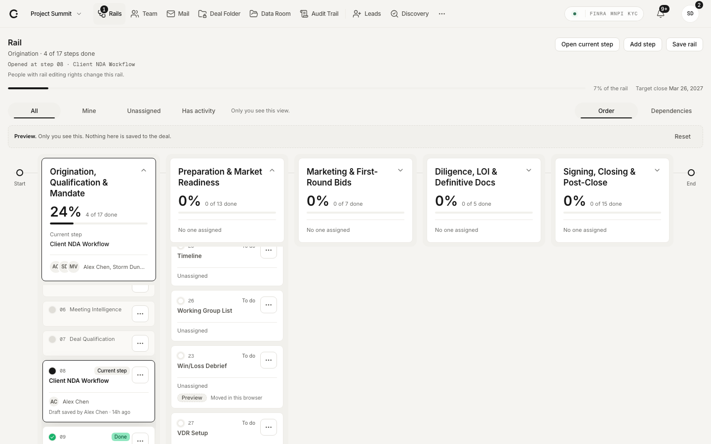

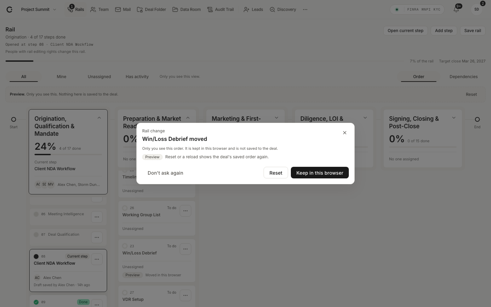

| What you can try | Where | Why it is not saved | Handoff |
|---|---|---|---|
| Move a step with "Move to..." or by dragging. After a move, the prompt offers Reset, "Keep in this browser" and "Don't ask again". Steps in Origination, done steps and required steps cannot move. | A deal's rail | Saving the new order needs new rules in the database | E1 |
| Drag steps on a template. A dashed line says "Publish changes leaves it out." | Rails configuration | Same as above | E1 |
| A new step lands highlighted and can be dragged into place | A deal's rail, after Add step | Uses the move Preview | E1 |
| "Propose a change", and a "View as deal lead" tray with Accept and Discard. Accept sends nothing. | A deal's rail, signed in without edit rights | Per-deal edit rights need a permission change by engineers | E3 |
| Draw hard or soft links between steps. "Waiting on" shows only for links someone drew, and a loop is refused. | Rail, Dependencies view | Dependency rules are not decided (handoff Questions 1 to 3) | E4 |
| A target or drop-dead date on a step, shown beside the real target close | A step's menu on the rail | Needs new date fields and notifications | E4 |
| "Import from Gmail" and "Import from Outlook" for your signature. They read and save nothing. | Settings › Mail | Needs storage and wider mailbox permissions | E7 |
| Title on your profile | Settings › Profile | The system has no place to store a title yet | E8 |
| Sample tasks on a Book deal page, under "Sample tasks. These are not this deal's work yet." | Book, deal page | Conductia has no task feature yet | E21 |
| The teaser sample draft, "Sample draft. Not written from this deal's data." | Teaser step | The tool that writes the draft does not read the deal's data yet | E39 |

The rail views (All, Mine, Unassigned, Has activity) are remembered in this browser too. Whether views should follow you across browsers, or be shared with the deal, is item E15.

## What we did not change, and why

### Open questions for Storm and Marco

The meeting left these open, so this work does not decide them. Where a prototype was asked for, it is labeled "Example, not decided". The full list, with options and quotes, is in [Part 2 of the handoff](../03-engineering/walkthrough-handoff-2026-10-22.md#part-2-questions-for-storm-marco-and-counsel). The rail questions are also in the [proposal](rail-multiplayer-and-dependencies-proposal.md), and the [rail prototype](../prototypes/rail-multiplayer/index.html) shows them.

- **The rail:** whether dependencies (one step waiting on another) change from deal to deal, block or only warn, and apply per buyer. Also who changes the rail for everyone and who approves, reusing part of one rail in another, hiding steps, and layout, zoom and gestures.
- **People:** who may invite whom, where outside invites start, and what a person's detail on Team shows. Also whether "Team" should be renamed, whether Leads is needed, what the access phases are called, who may remove a director, and whether an Observer (a read-only member) can own a step.
- **Skills and audit:** whether a revision should also improve the skill, what the AI should flag into the audit trail, and what an unsent draft or an override should leave there.
- **Mail and documents:** how much mail Conductia reads and how often, and whether the Data Room should look like the Deal Folder.
- **Words:** "rail", "phase" and "Conductor Center" stay for now and are open for Marco and Storm.

The website is not part of this branch. It follows as a separate draft pull request for Dan, Storm and Marco.

### Database and permission work for engineers

**This work made no database or permission changes.** It has no migrations (database updates) and no changes to RPCs (server functions), row-level security (who can read which row), authorization or notification types. It made one small read-only addition: the deal list now also returns the current step's owner, whether a draft is running, and progress per phase. The draft status and the progress go only to users at the bank (E14 and E19).

Reviews of this work found gaps in what the server allows today. Each one existed before this work. The screens now block, hide or relabel these cases so the flows can be tried as intended. The screens do not protect the data, though, because the server still allows these actions. Send these to engineers first ([Fix first](../03-engineering/walkthrough-handoff-2026-10-22.md#fix-first)):

- E20. Outside users with a firm role can see every deal in the firm.
- E23. Document uploads need server-side folder rules and Data Room filing.
- E24. Mail to an outside address skips recipient review when no deal is named.
- E25. Outside parties can read every seat on the deal (names, emails, roles).
- E26. Outside parties can read the deal's fee, schedule health and internal phase progress.
- E27. A director can remove the firm administrator, the CCO and other directors.
- E29. A read-only member can be made a step's owner.
- E30. Rail templates let anyone with edit rights remove steps every deal needs.
- E31. The invite list and the members list disagree about who can see a deal.
- E38. A read-only member can move the deal to the next step.

The handoff also covers what the Previews need to save for real (E1, E3, E4, E7, E8), recording skill steps as done (E28), live presence on the rail (E5), the mail scanning scope and cost (E12), and the not-now items: a buyer-side data room, @mentions on email threads and a bio for each lead (E16 to E18).

## Open calls for Lance

### Please check

These controls already existed and we removed or relabeled them. Each can be undone in one step by an engineer.

- **The mock pitch card is gone (C-25).** The deal home's "Compose the pitch" card showed made-up deal data as if it were real. An "Open current step" card replaces it.
- **"Draft with the {step} skill" shows only when the skill resolves (C-35).** Otherwise the step says "No skill attached yet." Steps with earlier drafts get "Open earlier drafts...". Locally, with no skill library running, most steps now show the no-skill line.
- **Steps every deal needs cannot be removed from a template (C-33).** Removing any other step now asks first. The same rule applies on a deal's rail.
- **"Mark complete" reads "Move to the next step" on skill steps (C-14).** The button only ever moved the deal on and never recorded the step as done, on develop too. Manual steps keep "Mark step complete". Recording it is E28.

### Taste calls from the review panel

Before this write-up, a panel of reviewers (AI reviewers playing different personas) read the screens. These are their judgment calls. They are not built. They are for you and Marco.

- The rail header holds many numbers: "Origination · 4 of 17 steps done", "Opened at step 08", "7% of the rail" and the target close.
- A step link's number (`?step=15`) follows the master list of steps, while the card shows the deal's own number (Step 11).
- An open phase column scrolls under its phase card, which stays fixed at the top, so the top cards show as thin slivers.
- To see steps outside the current phase, you first expand that phase.
- Lead results in the first screening step (Gate 0) look like a dropdown, but one Escape closes the whole setup wizard.
- The Data Room heading says "Deal documents" while the navigation says "Data Room". Folder names carry numbered prefixes ("00. Received from Client").
- Abbreviations remain: the "WGL" step and the "WGL and Team" folder.
- The Summit Origination card's avatar initials overlap.
- In the demo, Atlas shows the seller firm with 0 people, while Mike Cannon-Brookes sits under "Unaffiliated".
- The Audit filters Steps, Chats, Documents and Skills show "0 events", because the system files every record under Platform (this was true before this work).
- AI spend says "API calls", as agreed at the Oct 5 build sync. One reviewer suggested "requests".
- The phone "More" menu calls the deal home "Dashboard", and the admin Discovery page heading reads "Ingestion health" (a technical term for how mail is being read).
- Profile says "Director" for Storm while Team says "Managing Director": organization role versus deal seat (E41).
- A nickname equal to the full name shows as "Not set". The clean fix is in the system behind the screen, not on the screen.
- "You are not on this deal." also shows for a deal code that does not exist. The system answers both the same way on purpose, so it does not reveal which deals exist.

## Words we now use

The full list is in the app glossary, and an automatic check enforces the banned terms.

- **Step:** a unit of work on the rail. Prefer its name. Use "Step 32" only where order matters.
- **Rail:** the deal's workflow. The navigation label stays "Rails".
- **Phase:** always shown with its name, such as "Preparation". The number is secondary.
- **Current step:** where the deal is now. Never "In progress".
- **Conductor Center:** home across all your deals. "Conductor" only on the phone bar.
- **Invite to deal:** add a colleague at your firm. Replaces "Invite to platform".
- **Data room access:** how outside parties come in. It starts from the Data Room.
- **Team:** who is on this deal.
- **Organization:** firm seats and permissions, in Settings. Replaces "My organization".
- **What they can see:** how far into the deal a person can see, by phase name.
- **Joined:** replaces "On platform".
- **Conductia drafts..., you sign off:** how a step describes the work. The AI is never named.
- **Draft the teaser / Draft with the {step} skill:** a draft button names what it makes. Replaces "Draft this step".
- **Preview:** not saved yet. Chip text "Not saved yet. Engineers are wiring this."
- **Default rail:** the rail new templates start from. Replaces "Standard rail".
- **Rails setup:** the phone bar label for Rails configuration.
- **Sent despite a compliance flag:** the audit record of a send-as-is. The button stays "Send as-is".
- **Flagged at screening, sent anyway:** the matching audit screen row.
- **Oct 7, 2026:** the one date format.

## How to try it

### Run it locally

This section is for engineers. Use Node 22 and a local Supabase stack with the local `.env.local`. The demo seed refuses any database that is not local.

1. `npm ci`
2. `supabase db reset` (local only)
3. `npm run seed`
4. `node --env-file=.env.local --import tsx scripts/enable-flags.ts` turns every flag on. `npm run seed:flags:enable` fails without the env file (E36).
5. `npm run seed:demo-book`
6. `npm run seed:discovery -- --google-replay --corpus demo` (run it once more if it errors)
7. `npm run dev`, then open http://localhost:3000
8. Press "Or sign in with email" and sign in.

### Demo logins

Every account uses the password `conductia-local`.

| Login | Who |
|---|---|
| md.intelibank@dev.com | Storm Duncan, the MD |
| deal-team.intelibank@dev.com | Alex Chen, deal team |
| ib-director.intelibank@dev.com | Morgan Vale, director |
| legal.intelibank@dev.com | Jordan, legal |
| cco.intelibank@dev.com | Pat, CCO |
| admin.intelibank@dev.com | Firm administrator |
| read-only.intelibank@dev.com | Observer |
| nw-director.intelibank@dev.com, nw-member.intelibank@dev.com | Another firm |
| seller.intelibank@dev.com, buyer.intelibank@dev.com | Outside parties |

### A two-browser walk

This shows two people working on one rail.

1. In one browser, sign in as Storm (md.intelibank@dev.com). Open Project Summit, then Rails. Card 08, Client NDA Workflow, is the current step and belongs to Alex Chen.
2. In a second browser (or a private window), sign in as Alex (deal-team.intelibank@dev.com). Open the same rail and zoom into Client NDA Workflow. Alex sees no "Assign..." menus.
3. As Alex, tick an item in the checklist and press Save progress.
4. Switch back to Storm's window. When the tab regains focus, card 08 reads "Draft saved by Alex Chen · just now". With no focus change, it updates within 30 seconds.
5. To keep the demo tidy, untick the item as Alex and save again. The Audit Trail keeps both saves, under Alex's name.

Then try a Preview as Storm: drag a step in Preparation, read the prompt, and press Reset.
