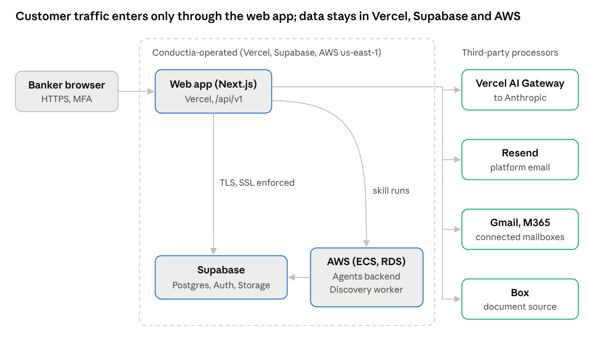

# Conductia Network Diagram

Conductia, Inc. Prepared 2026-10-25; reviewed and approved by Martin Casado.

Bankers reach Conductia only through the web app on Vercel over HTTPS; the web app is the one public entry point, and every connection behind it is encrypted in transit.

<figure>

<figcaption>Conductia network and data flows, as of 2026-10-25</figcaption>
</figure>

## Flows

| Flow | Encryption | Notes |
|----|----|----|
| Browser to web app | TLS (Vercel) | Supabase Auth session, MFA at AAL2 |
| Web app to Supabase | TLS; SSL enforced on all three databases | Row-level security per tenant |
| Web app to agents backend | TLS | Ignatious API for skill runs |
| Discovery worker to Supabase | TLS required | Connection string must carry `sslmode=require&uselibpqcompat=true` before the first deploy |
| Web app to third parties | TLS | AI Gateway to Anthropic, Resend, connected mailboxes, Box |

## Environments

Dev, staging and prod each have their own Supabase project; AWS resources run in us-east-1. Supabase network restrictions are not yet set, so the databases accept connections from any IP over SSL.
