# Walkthrough designer pack

For Marco, with Storm and Dan. It covers the product walkthrough of Oct 22, 2026 and the branch `feat/walkthrough-refinements` at `c2f1274f` (Oct 25, 2026).

Everything here is input for your redesign, not a decision. The branch made some provisional calls so Storm and Lance could try the flows in the app. You own the final views.

## How to use this pack

1. Read the one-minute summary.
2. Look through the screens and their notes.
3. Open the flow map and the rail prototype.
4. Bring the open questions to the two-day session with Storm.

## What the walkthrough asked for, in one minute

- **Plain English everywhere.** "Never make somebody use a reference for something that they have to go look up." And: "If there is anything on the page that increases noise but does not increase value", remove it.
- **A Conductor Center that works for 10 or more deals.** It should show what needs my judgment, what is running and where each deal is.
- **A rail you zoom into, like a Trello board.** Five phases side by side. Open a phase to see its steps as stacked cards. Open a step to see it with its neighbors either side, then zoom back out.
- **Several people working at once.** "Player 1 is over in step 5... player 2 is in step 1." Some steps must wait for others. Who may change the rail for everyone is still open.
- **Step views that say what they do.** The step name comes first. The skill preview and conversation should be up front. A free-text box should say what to change in a draft.
- **People screens that make sense.** Team means who is on this deal, and a person opens in place. Firm seats move into Settings. "Invite to deal" is for colleagues; outside parties get data room access.
- **A mail client that feels native.** It should look like Outlook or Gmail. Compliance checking is what makes it different.
- **Smaller fixes:**
  - a Person column in the audit trail;
  - one modal system;
  - Apple-style count badges;
  - a stripped-down profile;
  - one vocabulary in the app and on the website.

## What this build did

The branch changed screens and copy only, and added Previews that run in the browser. It made no database or permission changes.

Of the 229 notes-matrix rows:

| Status | Rows |
|---|---|
| Built | 154 |
| Built as Previews | 7 |
| Written up for engineers | 20 |
| Left as questions for Storm and you | 24 |

**These calls are provisional.** The branch made them so the flows could be tried in the app, not to settle the design. Please revisit each one.

| Call | What the branch does | What to revisit |
|---|---|---|
| Rail orientation | Five phase cards run left to right between Start and End markers. Pressing a phase opens its steps as a stack of cards under it, like a Trello column. On a phone the phases stack vertically. | Horizontal, vertical or board columns (handoff Question 14). From the meeting: "whether it goes out horizontal or vertical, I don't think really matters." |
| Zoom in and out | Zoom replaces the old two-view toggle. Clicking a step zooms into it, with the previous and next steps named either side. The zoom-out button (it shows the phase name) or Escape returns to the board with that phase open. The zoom animates from the card you pressed, and is instant for people who prefer reduced motion. A link to a step opens it zoomed. | Zoom depth, what the neighbors show, and whether a zoomed step is a page or a card. |
| Gestures | Pinch, or Ctrl and scroll, on a zoomed step returns to the board. Every zoom action also works from the keyboard. A code comment marks gestures and orientation as provisional for you. | Which gestures, and whether pinch should also zoom in. |
| Team detail inline | Each person on Team opens in place under their row, one at a time. It shows today's fields only: side, what they can see and status. | What a person's detail should show at all (Question 11). |
| Conductor Center order | The Console has a greeting line with counts, then "Needs your judgment" with one main button per item, then a line about new deals found in your mail, then "Your deals". Each deal row has a phase meter, the current step, who is on it, the target close and how many items need you. A "Running" card exists but stays hidden, because nothing records running work yet (engineer entry E19). One "View" control switches between Console and Book. | The overall order, and whether "Your deals" should be a table or cards. |
| One modal system | Create and confirm actions use a centered Dialog. Every 3-dot button opens a Menu. Record detail opens in place, with no right-hand slide-overs. Small panels with fields use a Popover. All of them share one scrim and one fade-and-rise motion. The only exceptions are the skill builder and the output review. The rule is written in [the components map](workbench/components-map.md). | Visual style, sizes and motion. |
| Preview chips | Anything not saved yet carries a "Preview" chip ("Not saved yet. Engineers are wiring this.") or the banner "Preview. Only you see this. Nothing here is saved to the deal.", with Reset. | How a Preview looks, and whether a banner and a chip are both needed. |

The seven Previews:

- moving steps on a deal's rail;
- moving steps on a rail template;
- a new step lands highlighted and can be dragged into place;
- "Propose a change", with a deal-lead review tray;
- dependency links drawn by hand, hard or soft;
- step target and drop-dead dates;
- importing a signature from Gmail or Outlook.

## Inspiration, and why

**Trello boards.** The meeting called Trello "beautifully, remarkably simple": a team gets a board and starts working without asking how it works.
- Borrow: columns of cards, faces on cards, and dragging straight on the board ("That's how you really steal from Trello").
- Avoid: Trello has no dependencies or gates. A plain board would hide the compliance gates a sell-side deal has.

**GitHub Projects (staged cards).** The meeting described "stage 1, 2, 3, 4, but within stage 1... a bunch of note cards".
- Borrow: one set of data with several saved views, such as board, table and roadmap. That is how Order, Dependencies and a timeline could be views of one rail.
- Avoid: developer furniture such as issue numbers, labels and custom fields. Issue numbers are banned from visible copy here.

**Vanta (progress and checklists).** "There's a percentage, how much have you gone through, and then just like a checklist. Not ideal, but sort of."
- Borrow: percent done and an owner on every item. The phase cards already show "N of M done".
- Avoid: the feeling of an endless checklist. An MD wants the decisions, not every task.

**Fellow.** Raised as "wondering if this should not be laid out a little bit more like Fellow". The meeting did not say which part, so ask Storm.
- Borrow: a calm page that reads like a document, with owners and action items next to the content they belong to.
- Avoid: building around meetings. In Conductia the unit of work is the deal step.

**Linear (dependencies and views).** This one comes from the benchmark notes in the rail proposal.
- Borrow: "Blocked by" and "Blocks" links that people draw by hand, and personal views kept clearly separate from team views. The branch labels its filters "Only you see this view".
- Avoid: guessing links automatically. The branch refuses to infer links from step references, because some of them point forward. Also avoid Linear's engineering words (issues, cycles, triage).

**Outlook and Gmail (mail).** The meeting asked for mail that "should feel and look almost identical. Except for the fact that we have our proactive compliance checking."
- Borrow: folders on the left, a message list, a reading pane, and writing a message in the pane.
- Avoid: rebuilding rules, filters and settings ("we just need the primary ones"). Also avoid team tasks on email threads, which the meeting set aside as "Superhuman all over again".

## Screens

All screens are from the branch with the demo data, at 1440px wide unless noted.

**1. Conductor Center, Console**

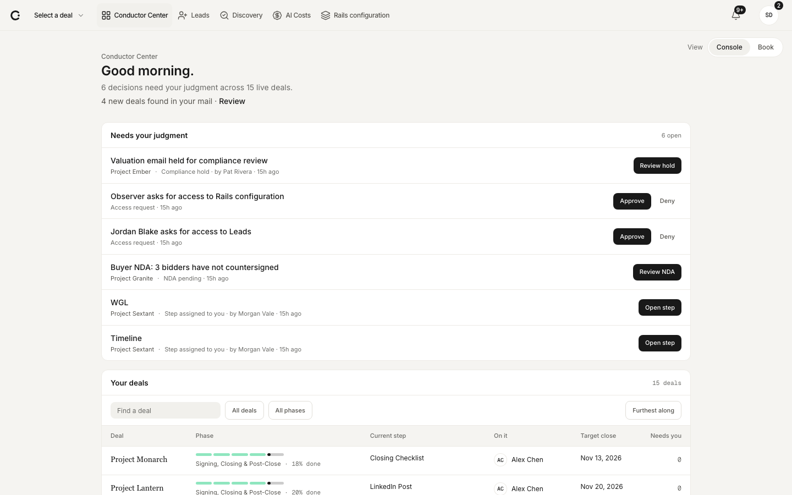

The greeting line counts the decisions waiting across the live deals. "Needs your judgment" comes first, with one main button per row, and "Your deals" follows. Notice the five-part phase meter on each deal row and how far down the page the deals start.

**2. Conductor Center, Book**

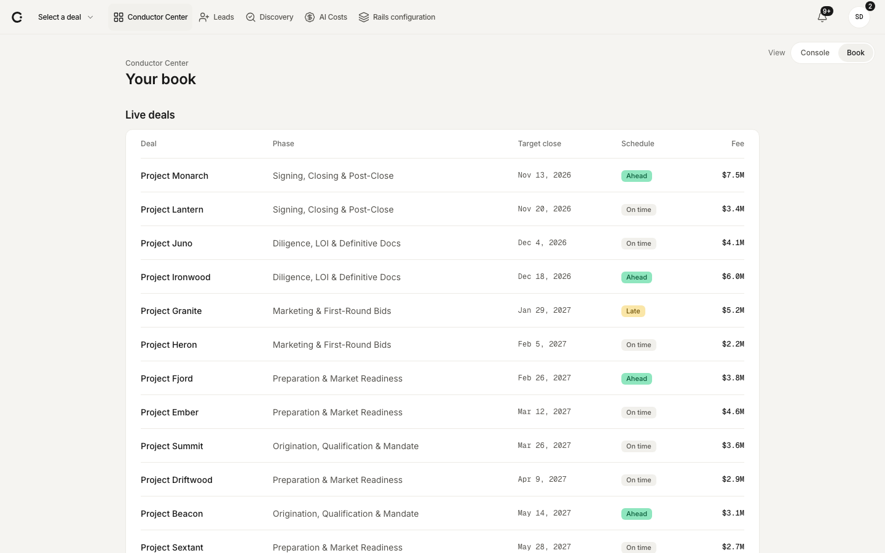

The same "View" control switches to Book. Notice the plain On time, Ahead and Late labels, the phase names instead of numbers, and the dates written as "Nov 13, 2026".

**3. Notifications and badges**

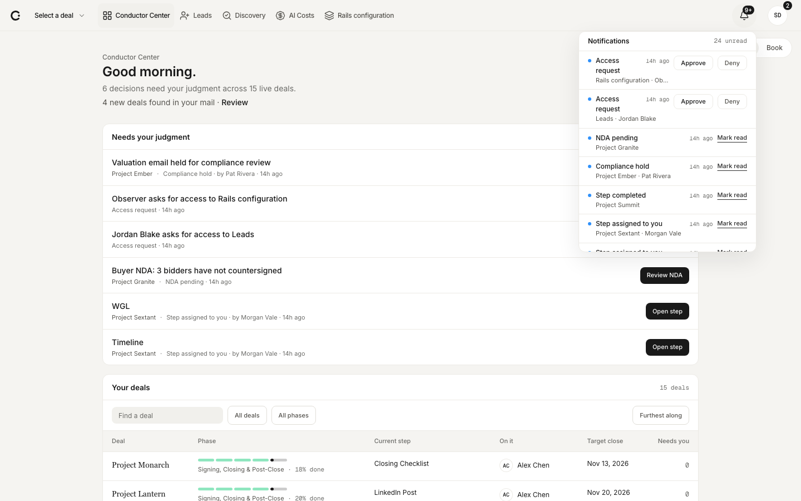

The bell remains the full inbox. Count badges sit on the icons they belong to, Apple style. Notice how dense the list is and the "9+" cap.

**4. Rail overview**

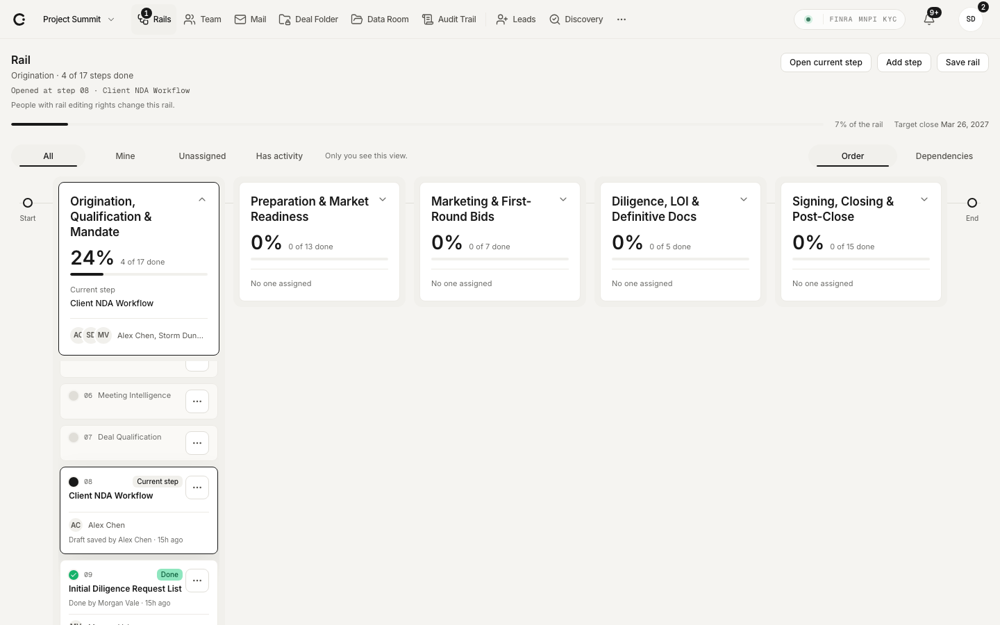

Five phase cards run left to right between Start and End. Each card shows percent done, "N of M done", the current step and who is working in it. Notice:
- one open phase stacks its steps underneath, leaving the rest of the width empty;
- every phase card is the same size, whether it has 5 steps or 17;
- the personal views (All, Mine, Unassigned, Has activity) sit next to Order and Dependencies.

**5. A Preview on the rail**

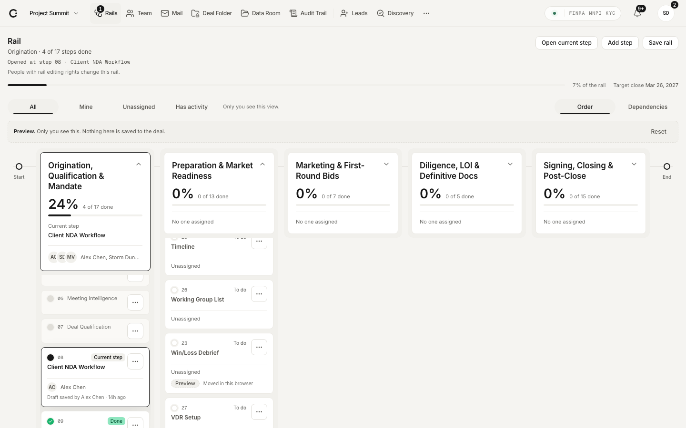

A step was moved in this browser. The banner and Reset sit above the board, and the moved card reads "Preview · Moved in this browser". This is the honest-preview pattern: keep it or restyle it, but never let unsaved work look saved.

**6. A zoomed step**

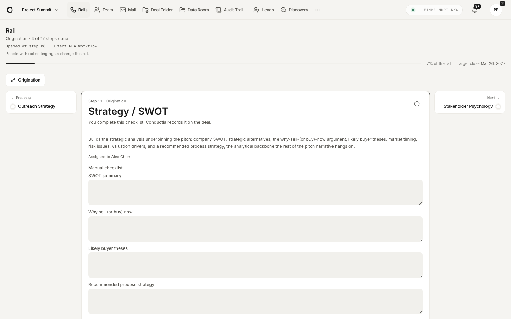

The step name is the largest text on the page, with "Step 11 · Origination" above it. One plain line says who does what. The previous and next steps sit either side, and the phase button top left zooms back out. Notice how small the neighbors are next to a long checklist.

**7. A skill step before any draft**

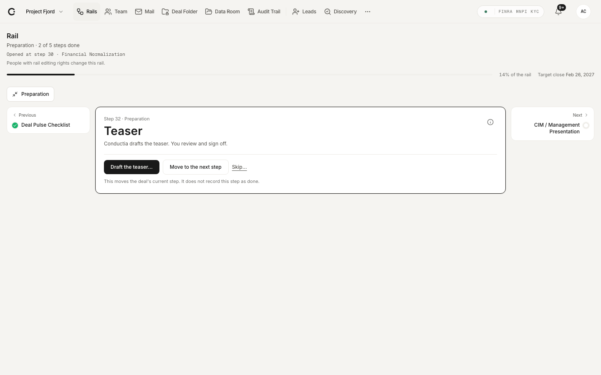

"Conductia drafts the teaser. You review and sign off." The main button names the output. "Move to the next step" says that it does not record the step as done. The meeting wanted the skill preview and conversation up front, and here they appear only once a draft exists. Where they sit is for session 4.

**8. The shared dialog**

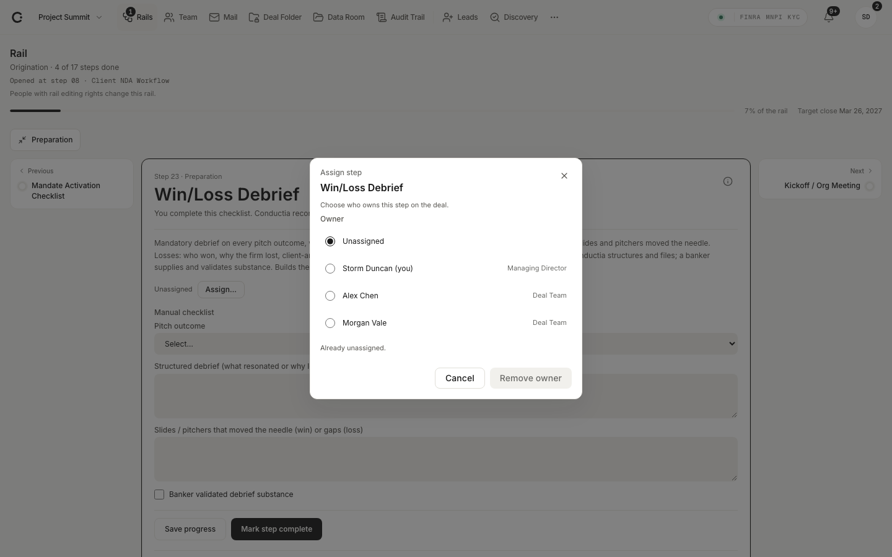

Assigning a step uses the centered Dialog over a dimmed page, as every create and confirm action does. Notice the role next to each name and the single primary action.

**9. Team, with a person open**

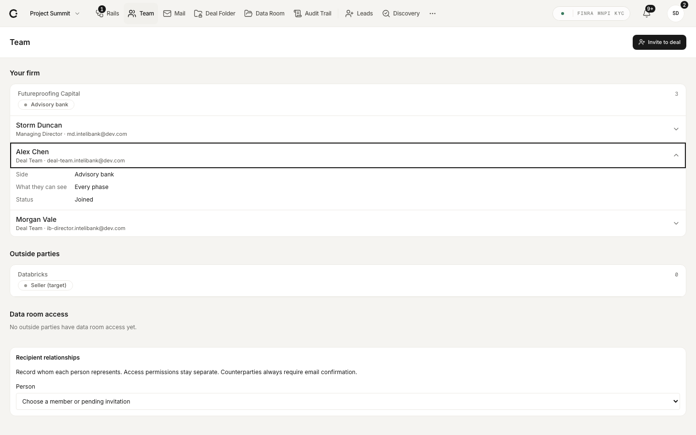

Alex Chen's details open in place under his row: side, what they can see and status. The page groups "Your firm", "Outside parties" and "Data room access". The detail is deliberately thin until Question 11 is answered.

**10. Settings, Organization**

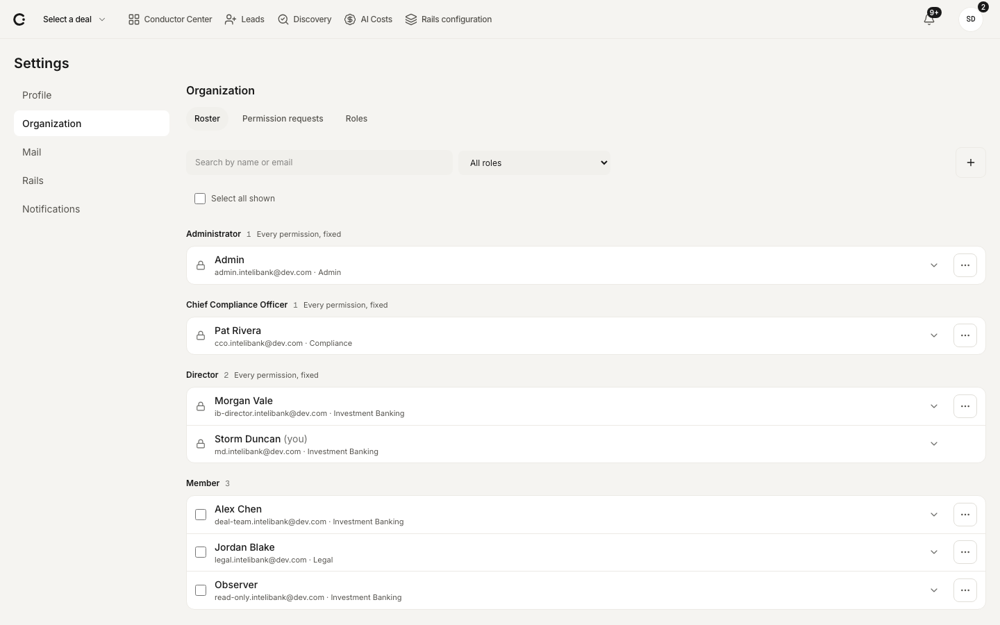

Firm seats now live in Settings, next to Profile, Mail, Rails and Notifications. The roster is grouped by role, with search, a role filter and multi-select. "My organization" is gone from the top navigation.

**11. Mail, writing a message**

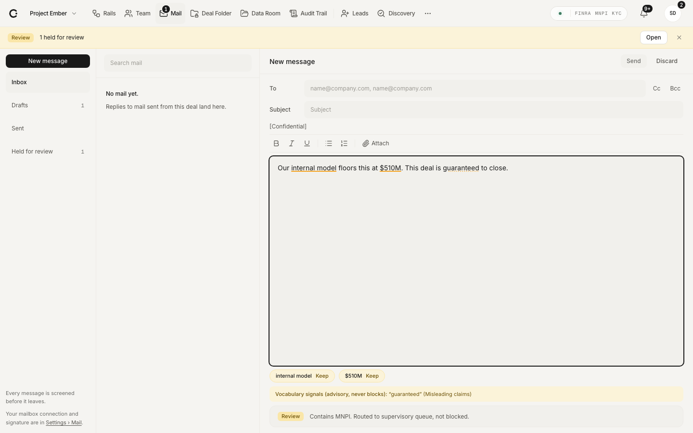

The layout is folders, list and a writing pane. The compliance checks are the part that is Conductia's own:
- the flagged phrases are marked in the text;
- an advisory vocabulary line sits under the message;
- the "Review" line says the message goes to the supervisory queue rather than being blocked.

Everything else should feel like Outlook or Gmail.

**12. Data Room**

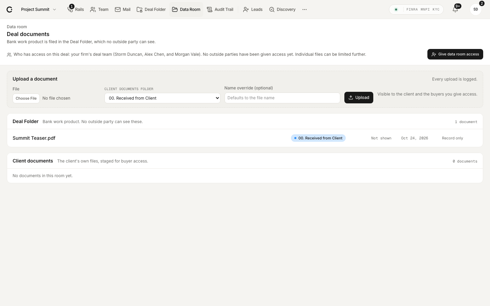

"Who has access on this deal" is written out in one line, and "Give data room access" is where outside invites start. Notice that the Data Room is a flat table with category pills, while the Deal Folder uses tinted folders (Question 18).

**13. Audit Trail**

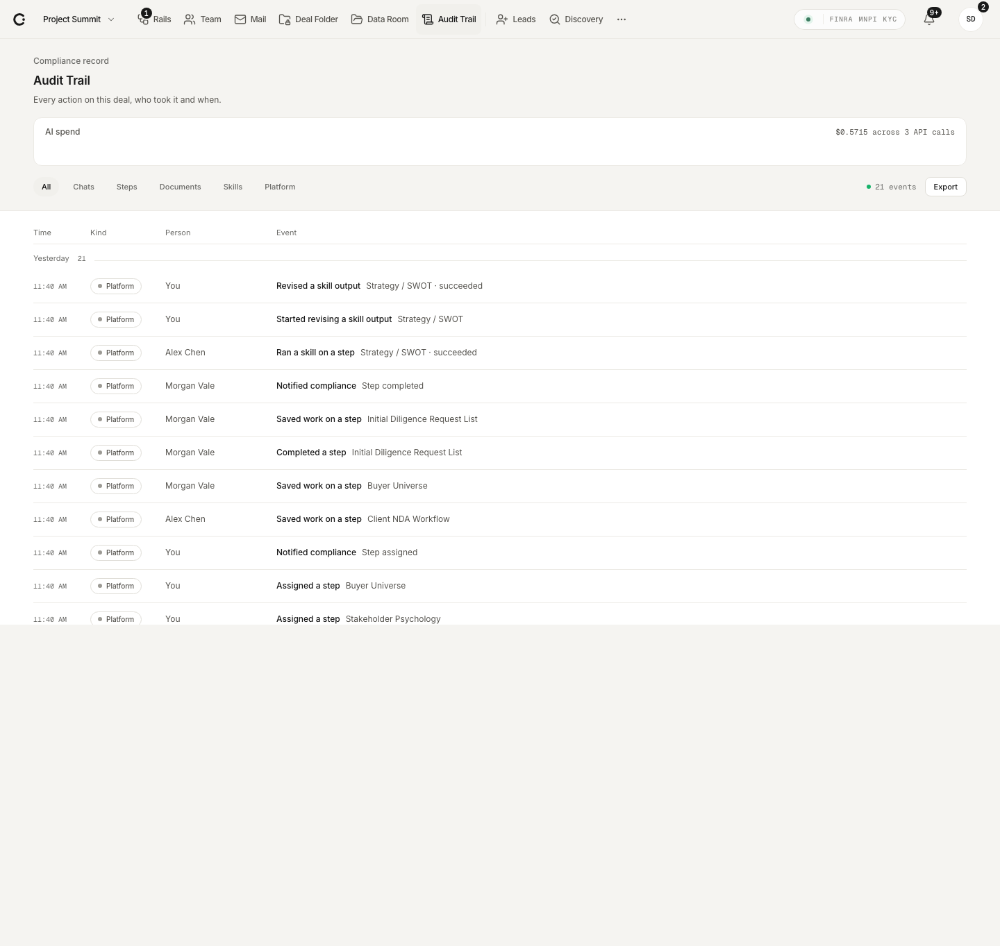

The Person column is new, and your own rows read "You". Events use plain names and step names. What the AI should add here is Question 13.

**14. Rail on a phone (390px)**

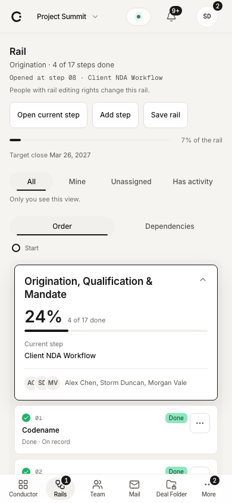

On a phone the phases stack vertically, the header buttons get full-size touch targets, and a bottom bar carries badges. This is defined behavior, not a design.

## Links

- **Flow map (As-is and To-be):** https://claude.ai/artifact/QCTbaipHwi8T59vQ92EUgg (private; ask Lance for access)
  - The To-be toggle colors every walkthrough note by its status on the branch.
  - Add `#tobe` to open it in To-be, or `#J05` to open the rail journey.
- **Rail multiplayer prototype:** [prototypes/rail-multiplayer](../prototypes/rail-multiplayer/index.html). It has Sequential, Dependency and Timeline views, simulated presence and one per-buyer gate, each labeled "Example, not decided".
- **Rail multiplayer and dependencies proposal:** [decisions for Storm](../02-product/rail-multiplayer-and-dependencies-proposal.md), with benchmarks.
- **Engineer handoff:** [walkthrough handoff](../03-engineering/walkthrough-handoff-2026-10-22.md). Part 2 has the questions and Part 3 has the agenda.
- **Principles and lessons:** [walkthrough principles](../02-product/walkthrough-principles-2026-10-22.md).
- **Overlay rule:** [components map](workbench/components-map.md).
- **The Claude design (Workbench):** [docs/design/workbench](workbench/). Start at [HANDOVER.md](workbench/HANDOVER.md), then open `Conductia Workbench.html` (the prototype) and `Workbench Kit.dc.html` (the kit), with `brand-spirit.md` and `tokens.css` beside them. This is the zip Lance shared. The branch builds on it, and where the walkthrough asked for something it froze, the walkthrough wins.

## Open questions for the design session

The numbers match Part 2 of the handoff.

- **14. Rail layout and zoom.** Horizontal phases that expand in place, a vertical list with a mini-map, or a board of phase columns?
- **1 to 3. Dependencies and gates.** How do links, "Waiting on", and hard versus soft show on a card? How does a per-buyer gate look?
- **4. Who changes the rail.** What does "Propose a change", and its review tray, look like for a junior and for the deal lead?
- **8. Reusing and hiding steps.** Is there a control to copy steps from another rail, or to hide a step for me or for this deal?
- **10. Revisions.** Where does "What should change?" sit, and does it offer to improve the skill?
- **11. Team detail.** What does a person's detail show, and does it change with the viewer's role?
- **12. Leads and the name "Team".** Keep, fold or hide Leads? Keep "Team", or use "Parties" for outside people?
- **7 and 17. Data room access.** Where do outside invites start? What are access phases called?
- **18. Data Room layout.** Should the Data Room use the same tinted folder list as the Deal Folder?

## Agenda for the two-day view session

This follows Part 3 of the handoff. The attendees are Storm, Marco and Lance, and each session runs 60 to 90 minutes.

| # | Session | Goal | From this pack |
|---|---|---|---|
| 1 | Vocabulary and the Conductor Center | Agree the words (step, rail, phase, Conductor Center) and the Today layout for 10 to 50 deals | Screens 1 to 3 |
| 2 | The rail as a board | Settle orientation, zoom, drag and drop, and what a card shows. Answer Question 14 | Screens 4 to 6, the Trello and GitHub Projects notes, the rail with two browsers signed in |
| 3 | Multiplayer and dependencies | Answer Questions 1 to 4, the host model, and block or warn | The prototype, the proposal, and one real deal's gates written out by Storm |
| 4 | Step view and skills | Settle the step hierarchy, the revise box and where compliance rules live | Screens 6 and 7, Questions 9 and 10 |
| 5 | People, roles and invites | Answer Questions 5, 7, 11, 12, 15, 16, 17, 20, 21 and 22 | Screens 9 and 10 |
| 6 | Mail, scanning and the audit trail | Answer Questions 6, 9, 13 and 19 | Screens 11 and 13 |
| 7 | Deal folder, data room and the buyer future | Answer the Question 7 follow-up and Question 18, and sketch the two-sided model for later (E16) | Screen 12 |
| 8 | Website and shared copy | Carry the app vocabulary to the website and fix the "capacity, consistency, compliance" cards | The website review and the hooks that worked |

Close the second day by turning every answer into a decision-log entry. Then mark the matching handoff entries as ready for engineering.
